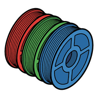

# Printing Profiles

A community website for sharing 3D printing slicer presets: settings for a specific material on a specific printer, backed by photos of real prints, with reviews and comments.

## Run the API locally

Needs Go 1.27.2 or newer and Docker. Dev needs no settings; `.env.example` lists the variables.

```bash
docker compose up -d       # local PostgreSQL
go -C api run . migrate    # create the tables and the starter catalog
go -C api run . serve      # then open http://localhost:8080/api/v1/printers
go -C api test ./...       # needs the database; add -short to skip the integration tests
```

## Run the site locally

Needs Node.js 24 or newer. Start the API first: the home page reads the catalog from it (`API_URL`, by default `http://localhost:8080`).

```bash
npm --prefix web ci          # install the exact package versions
npm --prefix web run dev     # then open http://localhost:3000
npm --prefix web test        # component tests
```

## License

- **Code:** [GNU AGPL-3.0](LICENSE). If you run a modified copy as a public website, you must publish your changes.
- **Uploaded presets:** CC BY 4.0 by default (share and adapt with credit). Uploaders can choose another license for each preset.
